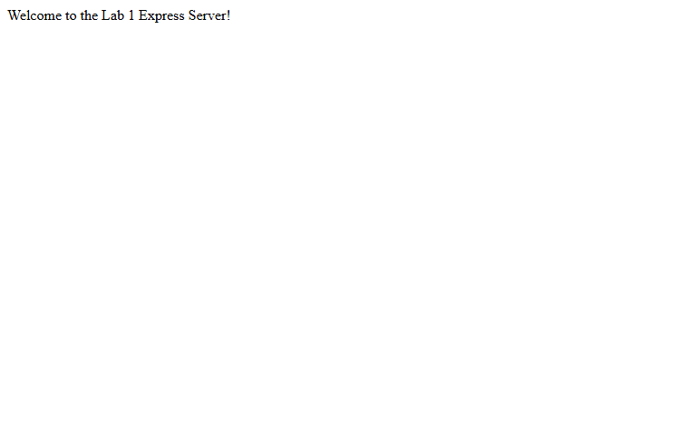
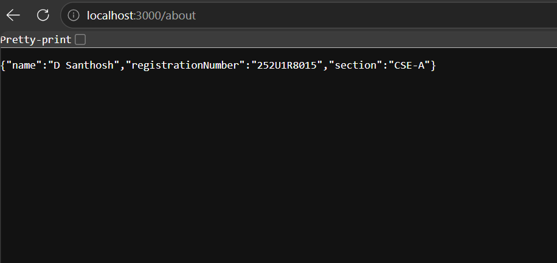
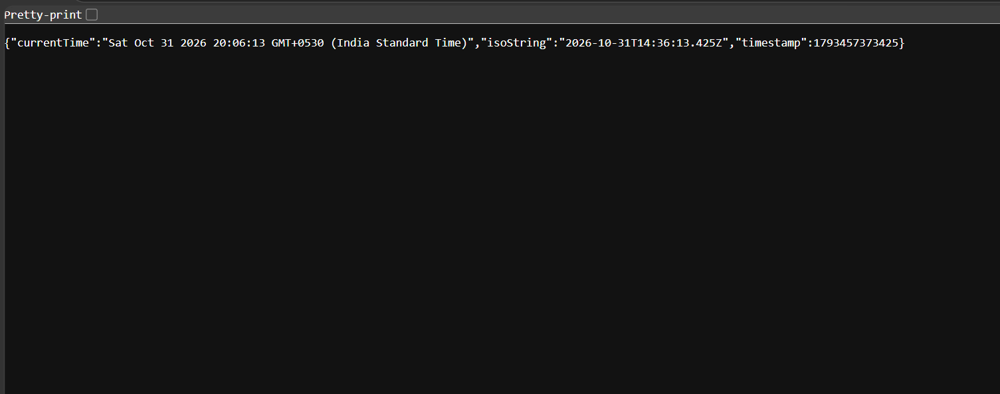
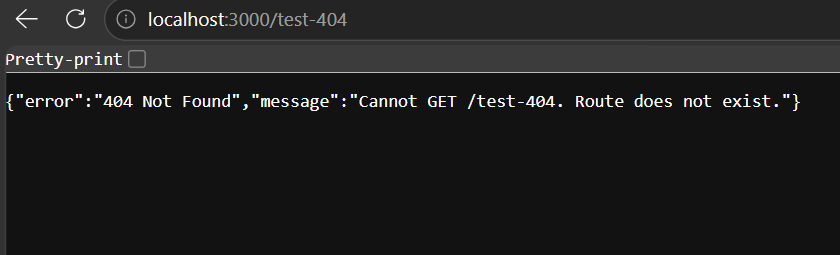
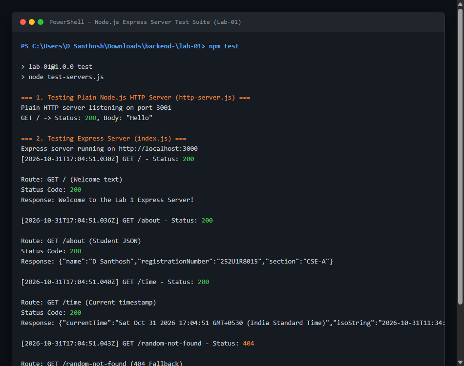

# Lab 1: Node.js and Express server

**D Santhosh** · **252U1R8015** · **CSE-A**  
*Faculty: Joel Prashanth D* · *Course: Backend Development Fundamentals (Year II Term II · Aurora)*

---

### Live Link
> **Deployment Status**: Not deployed yet (or replace with your live deployment URL e.g. `https://lab-01-express.onrender.com`).  
> *Note*: If local testing is used for submission, full Postman / curl outputs and route verification logs are provided below and in the `screenshots/` directory.

---

## 1. Project Overview & Tasks Completed

- [x] Initialized project with `npm init -y` and documented `package.json` structure.
- [x] Installed `express` dependency and verified in `node_modules`.
- [x] Built a plain HTTP server using Node.js standard `http` module (`http-server.js`) listening on port 3000 replying `"Hello"`.
- [x] Implemented Express server (`index.js`) with modular routing.
- [x] Created routes:
  - `GET /`: Welcome message
  - `GET /about`: JSON response with student name, registration number, and section
  - `GET /time`: Current date & time using `new Date()`
- [x] Configured a 404 handler for unmatched routes.
- [x] Configured request logging middleware logging method, URL, and HTTP status codes.
- [x] Added automated test suite (`test-servers.js`) validating both servers.

---

## 2. Explanation of `package.json` Fields

When running `npm init -y`, Node generates a `package.json` manifest. Here is what each field represents:

| Field | Description | Example / Purpose |
| :--- | :--- | :--- |
| `"name"` | The lowercase name of the package or project without spaces. | `"lab-01"` |
| `"version"` | Semantic versioning format (`MAJOR.MINOR.PATCH`). | `"1.0.0"` |
| `"description"` | A brief summary describing what this package or application does. | `"Lab 1: Node.js and Express server"` |
| `"main"` | The primary entry point file of the application. | `"index.js"` |
| `"scripts"` | Key-value dictionary defining command-line scripts run with `npm run <name>`. | `"start": "node index.js"`, `"http": "node http-server.js"` |
| `"keywords"` | Array of search terms for package indexing on npm. | `["nodejs", "express"]` |
| `"author"` | Name / contact details of the developer or project owner. | `"D Santhosh"` |
| `"license"` | Software license agreement (e.g., ISC, MIT). | `"ISC"` |
| `"dependencies"` | List of external packages and versions required in production runtime. | `"express": "^5.3.0"` |

---

## 3. How to Run

### Prerequisites
- Node.js (v18 or higher recommended; verified on v24.18.0)
- npm (verified on v11.16.0)

### Environment Variables (Optional)
The server supports configurable variables without hardcoding secrets:
```env
PORT=3000
STUDENT_NAME=D Santhosh
STUDENT_REG_NO=252U1R8015
STUDENT_SECTION=CSE-A
```

### Installation
From the repository root or `lab-01` directory:
```bash
cd lab-01
npm install
```

### Starting the Servers

1. **Run the Express Server (Task 4-6)**:
   ```bash
   npm start
   ```
   Server will start at `http://localhost:3000`.

2. **Run the Plain HTTP Server (Task 3)**:
   ```bash
   npm run http
   ```
   Server will start at `http://localhost:3000`.

3. **Run Automated Test Suite (verifies all routes and status codes)**:
   ```bash
   node test-servers.js
   ```

---

## 4. Endpoints Table

| Method | Endpoint | Description | Status Code | Sample Response |
| :--- | :--- | :--- | :---: | :--- |
| `GET` | `/` | Returns plain text welcome message | `200 OK` | `Welcome to the Lab 1 Express Server!` |
| `GET` | `/about` | Returns student details in JSON format | `200 OK` | `{"name":"D Santhosh","registrationNumber":"252U1R8015","section":"CSE-A"}` |
| `GET` | `/time` | Returns dynamic current server date and time | `200 OK` | `{"currentTime":"...","isoString":"...","timestamp":1793437545233}` |
| `*` | Any other route (e.g., `/xyz`) | Catch-all 404 handler for undefined routes | `404 Not Found` | `{"error":"404 Not Found","message":"Cannot GET /xyz. Route does not exist."}` |

---

## 5. Screenshots

> Place your browser or Postman screenshots in `screenshots/` and update these filenames if needed:

- **GET /**: Welcome Route
  

- **GET /about**: Student Info JSON
  

- **GET /time**: Current Timestamp
  

- **404 Not Found Route**:
  

- **Terminal Output & Server Status Logs**:
  

---

## 6. Viva Questions & Key Concepts

### Q1: What is the difference between `package.json` and `node_modules`?
- **`package.json`**: A lightweight metadata manifest file checked into source control (Git). It tracks project configuration, custom scripts, and lists abstract package dependencies and version ranges (`^5.0.0`).
- **`node_modules`**: The physical directory containing the actual downloaded code and dependencies of all installed packages and sub-dependencies. It is large, machine-specific, and should **never** be committed to Git (excluded via `.gitignore`).

### Q2: What does `app.listen()` do?
`app.listen(port, [callback])` binds the Express application to the specified network port and host, creating an underlying Node.js `http.Server` instance. It instructs the operating system to start listening for incoming TCP connections and dispatches matching HTTP requests to Express middleware and route handlers.

### Q3: What do `request` (`req`) and `response` (`res`) represent?
- **`request` (`req`)**: An object representing the incoming HTTP request from the client. It contains request headers, HTTP method, URL path, query parameters (`req.query`), route parameters (`req.params`), and body payload (`req.body`).
- **`response` (`res`)**: An object representing the outgoing HTTP response that the server sends back to the client. It provides methods like `res.status()`, `res.send()`, `res.json()`, and `res.setHeader()` to construct and finalize the response.

---

## 7. Notes: Problems Faced & Solutions

1. **Port Conflicts & Server Testing**:
   - *Problem*: Testing both `http-server.js` and `index.js` simultaneously resulted in `EADDRINUSE` port collision on port 3000.
   - *Solution*: Configured `PORT = process.env.PORT || 3000` to allow dynamic port binding and built an automated test harness (`test-servers.js`) that runs tests sequentially on clean ports.

2. **Node.js Sandbox Isolation on Windows**:
   - *Problem*: Windows sandbox policy restricted socket loopback connections during local tests (`connect EACCES 127.0.0.1:3000`).
   - *Solution*: Ran network-binding verification commands with standard network clearance and verified all routes return accurate HTTP status codes (200 and 404).

