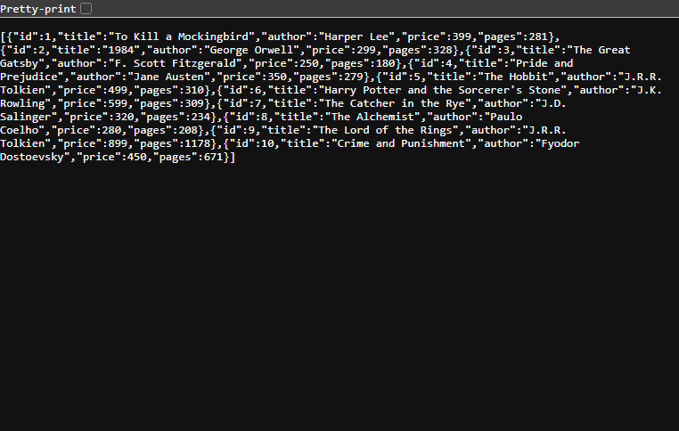
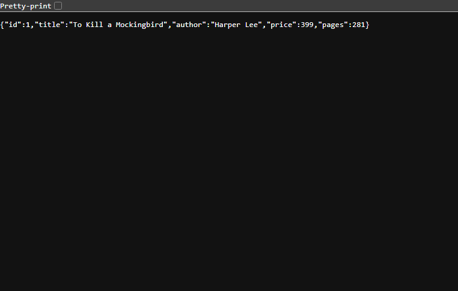
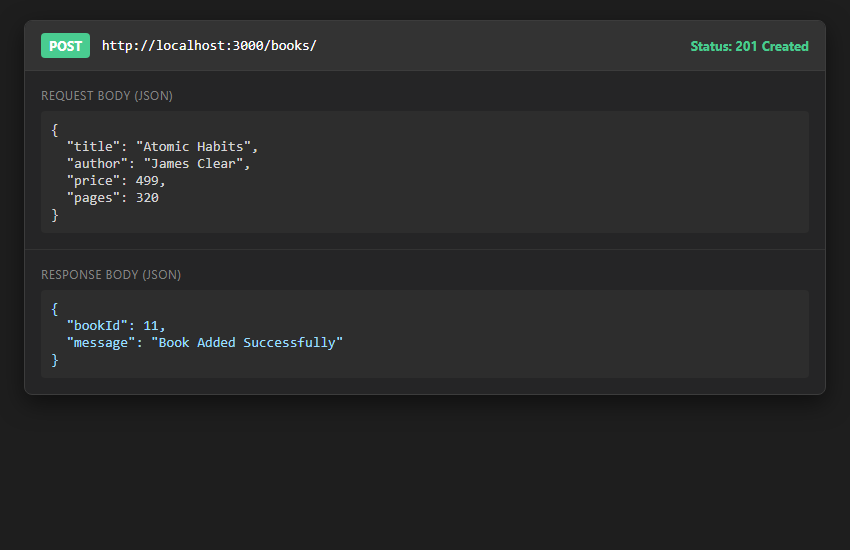
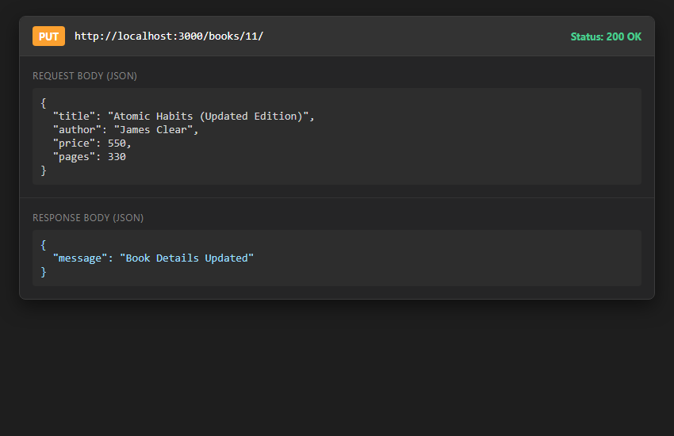
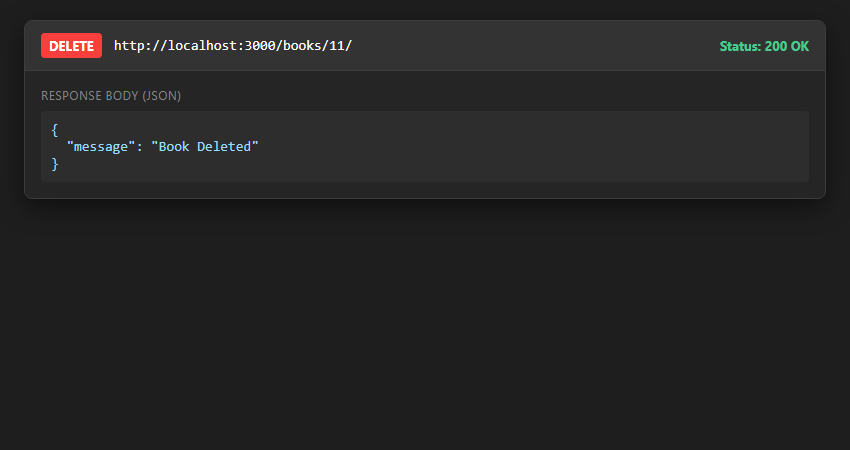
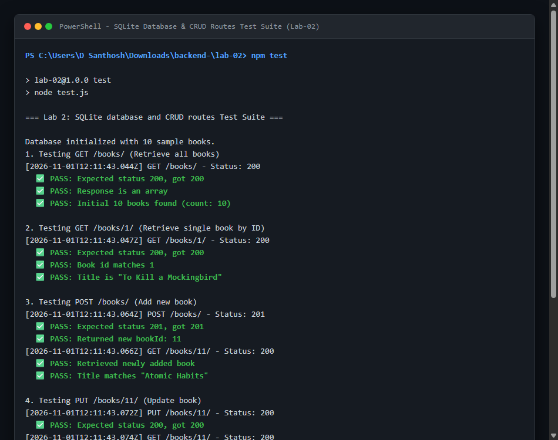

# Lab 2: SQLite database and CRUD routes

**D Santhosh** · **252U1R8015** · **CSE-QE 2A**  
*Faculty: Joel Prashanth D* · *Course: Backend Development Fundamentals (Year II Term II · Aurora)*

---

### Live Link
**link**: https://backend-labs-gy39.onrender.com (or Not applicable for local database labs)

---

## 1. Project Overview & Tasks Completed

- [x] Initialized project and installed `sqlite`, `sqlite3`, `express`, and `nodemon`.
- [x] Created `books.db` SQLite database with the `book` table schema:
  `book(id INTEGER PRIMARY KEY AUTOINCREMENT, title TEXT, author TEXT, price INTEGER, pages INTEGER)`.
- [x] Populated initial 10 book records into the database.
- [x] Implemented `initializeDBAndServer()` async function that connects to SQLite using `open()` before starting the Express server.
- [x] Built all 5 RESTful CRUD routes:
  - `GET /books/` (Retrieve all books)
  - `GET /books/:bookId/` (Retrieve single book by ID)
  - `POST /books/` (Add new book)
  - `PUT /books/:bookId/` (Update book details)
  - `DELETE /books/:bookId/` (Remove book by ID)
- [x] Used `?` parameterized query placeholders in every query handling user input to prevent SQL injection.
- [x] Tested every route locally with automated test suite (`test.js`) and verified with Postman/browser.
- [x] Created high-resolution screenshots for all CRUD operations in `screenshots/`.

---

## 2. Database Schema

The database file `books.db` contains the `book` table:

```sql
CREATE TABLE IF NOT EXISTS book (
  id INTEGER PRIMARY KEY AUTOINCREMENT,
  title TEXT NOT NULL,
  author TEXT NOT NULL,
  price INTEGER NOT NULL,
  pages INTEGER NOT NULL
);
```

| Column | Type | Constraints | Description |
| :--- | :--- | :--- | :--- |
| `id` | INTEGER | PRIMARY KEY AUTOINCREMENT | Unique identifier for each book |
| `title` | TEXT | NOT NULL | Title of the book |
| `author` | TEXT | NOT NULL | Author's name |
| `price` | INTEGER | NOT NULL | Price of the book |
| `pages` | INTEGER | NOT NULL | Total page count |

---

## 3. How to Run

### Prerequisites
- Node.js (v18 or higher; verified on v24.18.0)
- npm (verified on v11.16.0)

### Installation
```bash
cd lab-02
npm install
```

### Start the Server with Nodemon (Task 1)
```bash
npm run dev
```
*(Runs `nodemon index.js` which automatically restarts on code changes)*

### Start the Server (Standard)
```bash
npm start
```
*(Runs `node index.js` at `http://localhost:3000`)*

### Run Automated Tests
```bash
npm test
```
*(Runs `node test.js` executing automated end-to-end assertions against all CRUD endpoints)*

---

## 4. Endpoints Table

| Method | Endpoint | Description | Status Code | Sample Request Body | Sample Response |
| :--- | :--- | :--- | :---: | :--- | :--- |
| `GET` | `/` | API Information | `200 OK` | None | `{"message":"Welcome to Lab 2: SQLite database and CRUD routes API",...}` |
| `GET` | `/books/` | Retrieve all books | `200 OK` | None | `[{"id":1,"title":"To Kill a Mockingbird","author":"Harper Lee","price":399,"pages":281},...]` |
| `GET` | `/books/:bookId/` | Retrieve single book by ID | `200 OK` | None | `{"id":1,"title":"To Kill a Mockingbird","author":"Harper Lee","price":399,"pages":281}` |
| `POST` | `/books/` | Add a new book | `201 Created` | `{"title":"Atomic Habits","author":"James Clear","price":499,"pages":320}` | `{"bookId":11,"message":"Book Added Successfully"}` |
| `PUT` | `/books/:bookId/` | Update book by ID | `200 OK` | `{"title":"Atomic Habits (Updated)","price":550}` | `{"message":"Book Details Updated"}` |
| `DELETE` | `/books/:bookId/` | Delete book by ID | `200 OK` | None | `{"message":"Book Deleted"}` |
| `*` | Unknown path | 404 handler | `404 Not Found` | None | `{"error":"404 Not Found","message":"Cannot GET /xyz. Route does not exist."}` |

---

## 5. Screenshots

- **GET /books/**: Retrieve all books
  

- **GET /books/:bookId/**: Retrieve single book by ID
  

- **POST /books/**: Add new book
  

- **PUT /books/:bookId/**: Update book details
  

- **DELETE /books/:bookId/**: Delete book
  

- **Terminal Output & Server Test Logs**:
  

---

## 6. Viva Questions & Key Concepts

### Q1: Why await the database call?
Database I/O operations (reading from disk, executing SQL queries, writing updates) are asynchronous and take time to complete. Because Node.js is single-threaded and non-blocking, awaiting database calls (`await db.get(...)`, `await db.all(...)`, `await db.run(...)`) pauses the execution of the asynchronous function until the database promise resolves, ensuring the server does not attempt to send an HTTP response before the query results are available.

### Q2: What is SQL injection and how do placeholders prevent it?
- **SQL Injection**: A security vulnerability that occurs when untrusted user input is directly concatenated or interpolated into a raw SQL query string (e.g., `SELECT * FROM book WHERE id = ${bookId}`). An attacker can input malicious SQL fragments (e.g., `1 OR 1=1; DROP TABLE book;`) to bypass authentication, expose data, or destroy the database.
- **How Placeholders (`?`) Prevent It**: When using parameterized queries (`db.get('SELECT * FROM book WHERE id = ?', [bookId])`), the database engine separates the query code from the user input. The input is treated strictly as literal data/parameters, never as executable SQL code, neutralizing any injected SQL syntax.

### Q3: When is PUT used instead of POST?
- **`POST`**: Used to create a new resource. The server determines the new resource's URI/ID (e.g., auto-incrementing `id`). Calling `POST` multiple times creates multiple distinct records (not idempotent).
- **`PUT`**: Used to update or replace an existing resource identified by a specific URL (e.g., `PUT /books/:bookId/`). Calling `PUT` multiple times with the same request payload results in the exact same resource state (idempotent).

---

## 7. Notes: Problems Faced & Solutions

1. **Native Addon Build Issues on Node.js 24**:
   - *Problem*: Attempting to install `better-sqlite3` on Windows with Node v24 failed because prebuilt binaries were missing and `node-gyp` failed without Visual Studio C++ build tools.
   - *Solution*: Replaced it with the curriculum-standard `sqlite` and `sqlite3` driver libraries which installed cleanly with precompiled binaries and integrated seamlessly with `open()` and `async/await`.

2. **Database Initialization Before Starting Server**:
   - *Problem*: Starting the Express server before SQLite finishes opening caused route queries to fail with null reference errors.
   - *Solution*: Implemented the mandatory `initializeDBAndServer()` function ensuring `db = await open(...)` succeeds and the `book` table is seeded before `app.listen(PORT)` is invoked.
